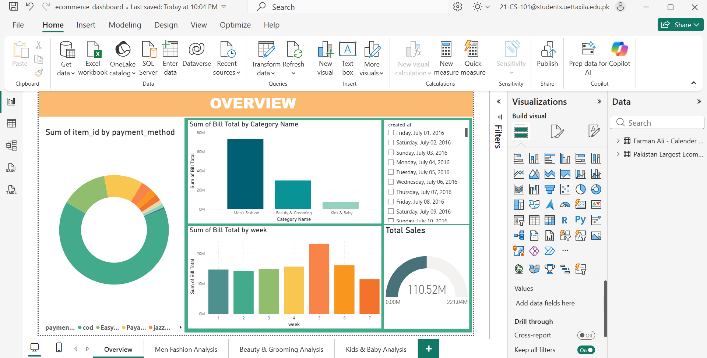
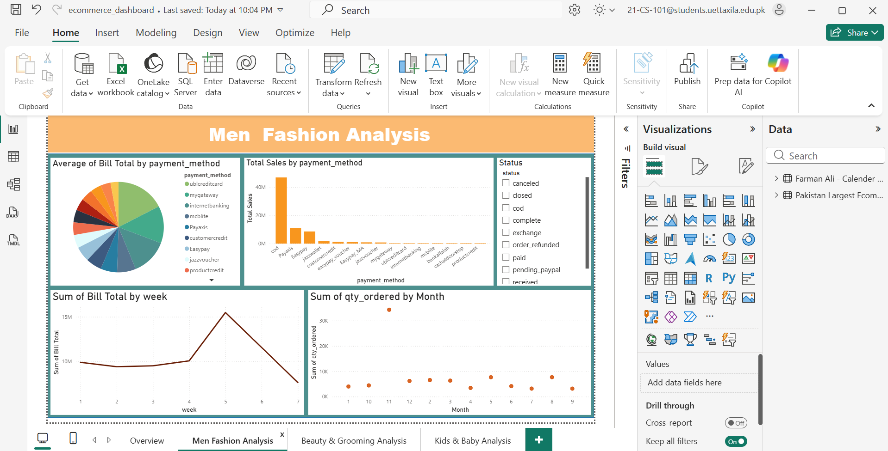
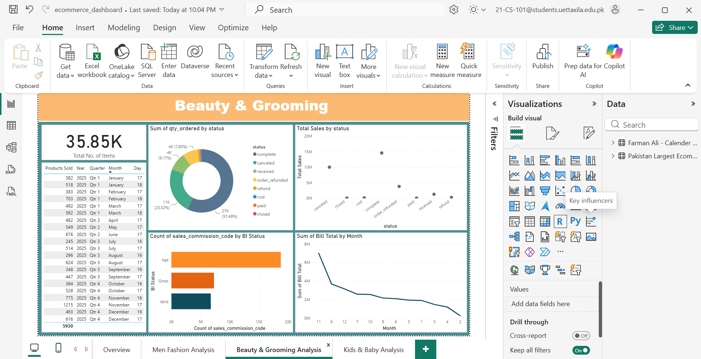
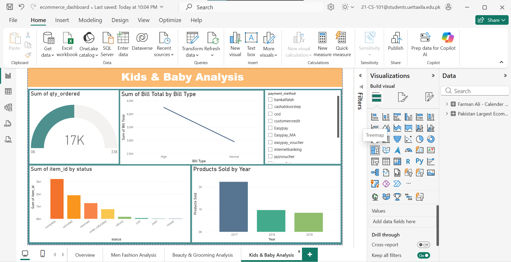

# Pakistan E-Commerce Power BI Dashboard

## Project Overview

This project explores Pakistan's e-commerce sales data using Microsoft Power BI to uncover insights into sales performance, product categories, and customer purchasing behavior.

The goal is to transform raw transactional data into meaningful business insights through interactive dashboards, data visualization, and analysis.

## Objectives

- Analyze overall e-commerce sales and order performance.
- Identify trends across major product categories.
- Compare category-level sales performance.
- Explore customer purchasing behavior.
- Present key metrics and insights through interactive dashboards.
- Demonstrate a practical data analysis and business intelligence workflow.

## Tools & Technologies

- **Power BI** — Dashboard development and data visualization
- **Microsoft Excel** — Data cleaning and preparation
- **Data Analysis** — Exploring sales trends and category performance
- **Data Visualization** — Presenting business metrics and insights

## Dashboards Included

### 1. Overview Dashboard
- Overall sales and order performance
- Sales contribution across product categories
- High-level business performance indicators

### 2. Men's Fashion Analysis
- Sales trends in men's fashion
- Category performance comparisons
- Insights into product demand

### 3. Beauty & Grooming Analysis
- Beauty and grooming category performance
- Product sales comparisons
- Customer purchasing trends

### 4. Kids & Baby Analysis
- Sales performance of kids' and baby products
- Category-level demand trends
- Product performance comparisons

## Dashboard Previews

### Overview Dashboard

### Men's Fashion Analysis

### Beauty & Grooming Analysis

### Kids & Baby Analysis

## Dataset Information

The original dataset used for this project is not included in the repository because of its size.

A sample dataset, `sample_dataset.xlsx`, is provided to demonstrate the data structure and fields used during analysis.

## Project Files

- `ecommerce_dashboard.pbix` — Power BI dashboard file
- `sample_dataset.xlsx` — Sample dataset for reference
- `Images/` — Dashboard preview images
- `README.md` — Project documentation

## Key Learnings

- Preparing data for analysis
- Exploring e-commerce sales patterns
- Comparing product category performance
- Designing interactive business intelligence dashboards
- Communicating data insights through visualizations

## Author

**Farman Ali**

BS Computer Science | Aspiring Data Analyst

**Skills:** Power BI, SQL, Python, Excel, Data Visualization

[LinkedIn](https://www.linkedin.com/in/farman-ali-computer-scientist) · [GitHub](https://github.com/FarmanAliDevdynamos)
